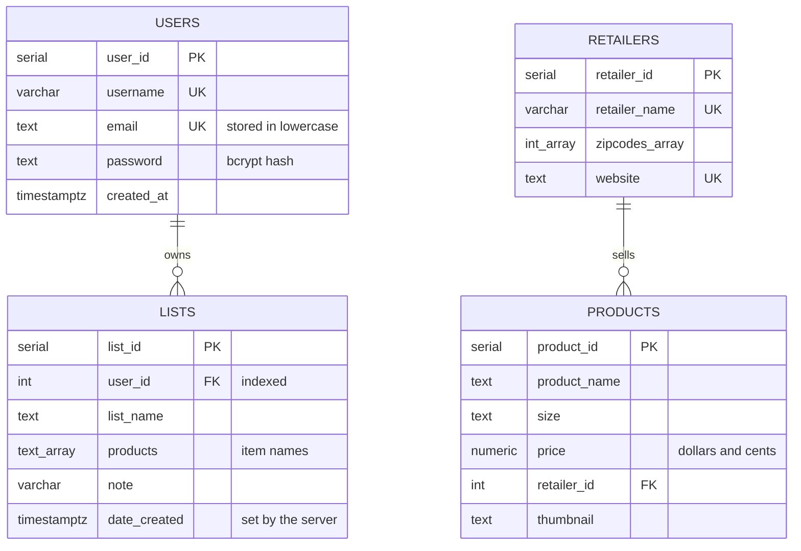

# CoinMatters API

CoinMatters helps shoppers compare grocery prices across nearby stores. A
user builds a grocery list, enters a ZIP code, and sees which store has each
item for less. This repository is the Express and PostgreSQL API behind the
[CoinMatters frontend](https://github.com/antunishdPursuit/coinmatterscapstone-frontend).

## Credits

CoinMatters began as a team capstone project built by **Irwin Jorge**,
**Noni Porter** and **Dennys Antunish**, with **Lakisha Johnson**, who
shaped the initial layout and contributed code. Tech mentor **Will
Dickerson** helped design the data model, and design mentor **Dillon
Eversman** guided the page layout. This copy continues that work: it
updates the dependencies, hardens security, and adds a database setup
command and automated tests.

## What it does

- Registers and logs in users. Passwords are stored as bcrypt hashes, and a
  login sets an HttpOnly session cookie that lasts one hour.
- Serves the product catalog and the stores that carry each product.
- Lets a logged-in user create, read, rename and delete their own grocery
  lists, and no one else's.

Matching list items to products, filtering stores by ZIP code and finding
the cheapest option all happen in the browser, using the catalog this API
serves.

## Requirements

- Node.js 20 or newer (tested on Node 24)
- PostgreSQL 16

## Run it locally

1. Install the dependencies.

   ```bash
   npm install
   ```

2. Create an empty database. Any PostgreSQL 16 server works. With Docker,
   for example:

   ```bash
   docker run --name coinmatters-postgres -e POSTGRES_USER=coinmatters -e POSTGRES_PASSWORD=choose-a-password -e POSTGRES_DB=coinsmatter_dev -p 127.0.0.1:35432:5432 -d postgres:16
   ```

3. Copy `.env.example` to `.env` and fill it in. `PG_ADMIN_USER` is the
   database owner (in the example above, `coinmatters`); `PG_USER` is the
   limited account the app runs as, which the next step creates. `PG_PORT`
   must match the database's port (`35432` in the example above).

4. Create the tables, load the sample data and create the app's account.
   This is safe to run again at any time; it also brings an older database
   up to date.

   ```bash
   npm run db:setup
   ```

5. Start the API.

   ```bash
   npm start
   ```

The sample data includes a login for trying the app locally:
`testuser@example.com` with the password `password123`.

## Tests

```bash
npm test
```

The tests start the app on a free port and use the database in `.env`.
They create their own users and remove them when they finish.

## API

Every response is JSON except `GET /`. Errors look like
`{ "error": "..." }`. Requests that change data must send
`Content-Type: application/json` (a `DELETE` without a body is the one
exception) or they get 415. Requests that need a login must include the
session cookie, so a browser client has to send credentials (in axios,
`withCredentials: true` on the request or the instance). Only the site in
`ORIGIN_URL` may call the API from a browser.

| Method | Path | Login | Notes |
|---|---|---|---|
| GET | `/health` | | `{ status: "ok" }`, or 503 if the database is unreachable |
| POST | `/register` | | `{ username, email, password }`. 201; 400 for invalid input; 409 if the username or email is taken |
| POST | `/login` | | `{ email, password }`. Sets the session cookie and returns `{ message, user }`; 401 for wrong details |
| POST | `/logout` | | Clears the session cookie |
| GET | `/check-login` | yes | `{ message, user }` |
| GET | `/user` | yes | `{ message, authorizedData }`, where `authorizedData` is the logged-in user |
| GET | `/products` | | Every product, with `price` as a number |
| GET | `/products/:id` | | One product |
| GET | `/retailer` | | Every store, with the ZIP codes it serves |
| GET | `/retailer/:id` | | One store |
| GET | `/lists/user/:user_id` | own | `{ user, lists }` |
| POST | `/lists/:user_id` | own | `{ list_name, products?, note? }`. 201 with the new list; the server sets `date_created` |
| PUT | `/lists/user/:user_id/:id` | own | Replaces `list_name`, `products` and `note`; send all three |
| DELETE | `/lists/user/:user_id/:id` | own | Deletes the list |

"own" means the `user_id` in the path must be the logged-in user's; other
users' lists answer 403 or 404. An `:id` or `:user_id` that isn't a
whole number gets 400. A `user` is `{ user_id, username, email }`; the API
never returns password hashes.

Input rules: usernames are 3 to 30 letters, numbers, dots, dashes or
underscores; passwords are at least 8 characters and at most 72 bytes, where
accented letters and emoji take 2 to 4 bytes each; list names are 1 to 255
characters; a list holds up to 500 item names. Too many failed logins (10 in
15 minutes) or new accounts (5 in an hour) from one address get 429.

## Data model



A list stores its items by name rather than linking to products, because
the same item is a separate product row at each store; the browser matches
names to products when comparing prices. `db/schema.sql` creates the
tables, `db/upgrades.sql` updates tables made by an older version,
`db/seed.sql` holds the sample data, and `db/more-products.sql` adds 10
more groceries to each store, including in databases set up earlier. Their
prices are sample data, not real store
prices.

## Known limits

- ZIP codes are stored as numbers, so a code with a leading zero (such as
  02134) loses it. The frontend matches ZIP codes the same way, and the
  sample stores are all in New York City.
- The session cookie is marked `Secure`. Browsers accept it on `localhost`
  and `127.0.0.1`; anywhere else the API must be served over HTTPS.
